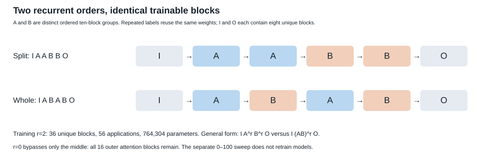
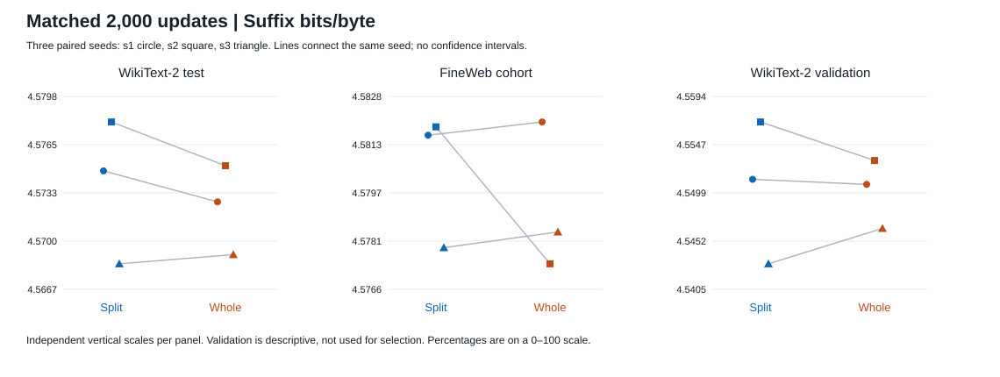
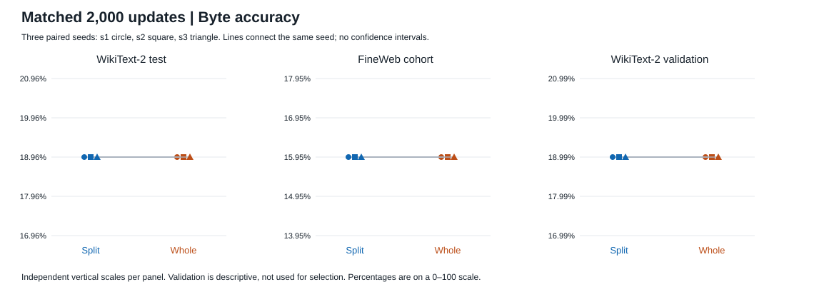
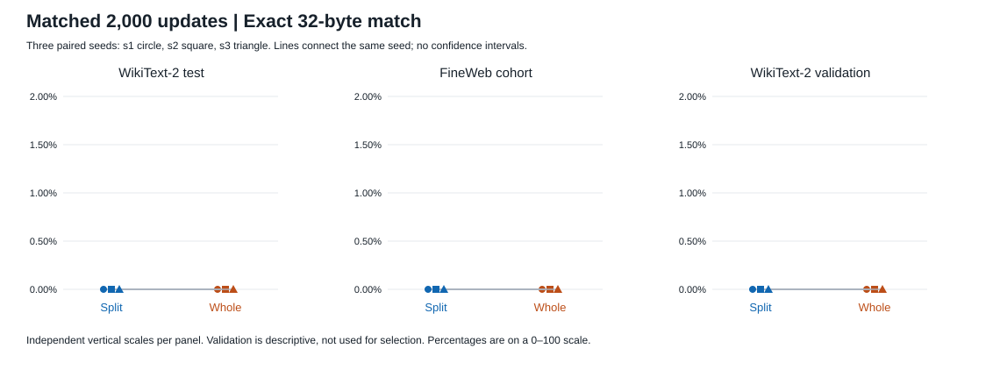
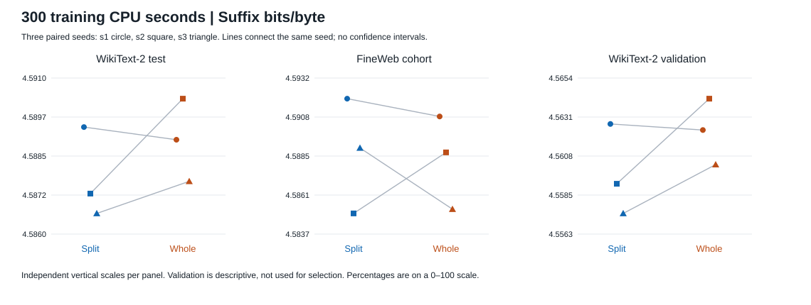
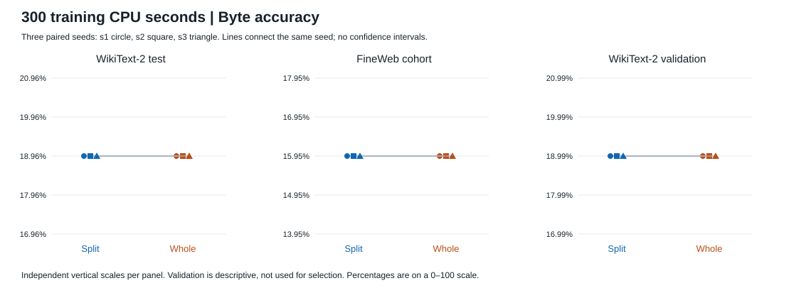
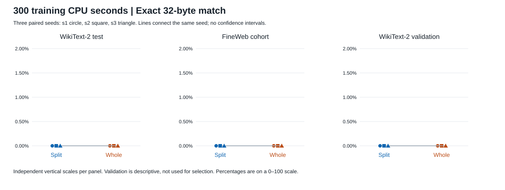
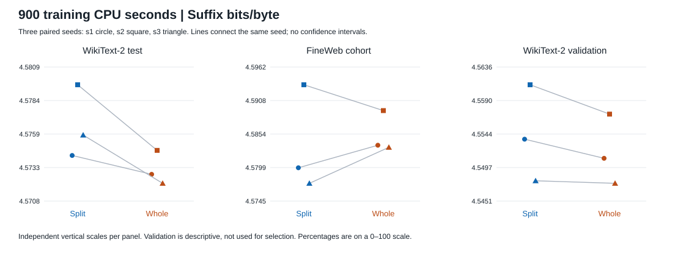
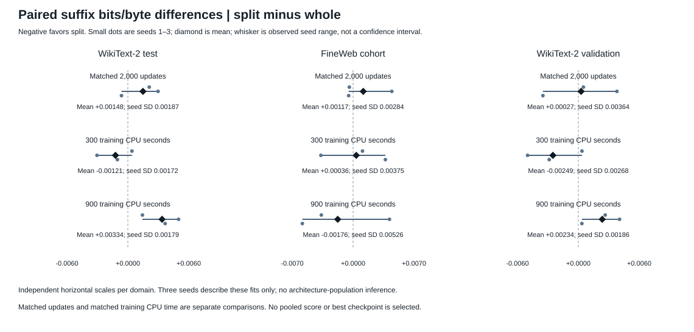
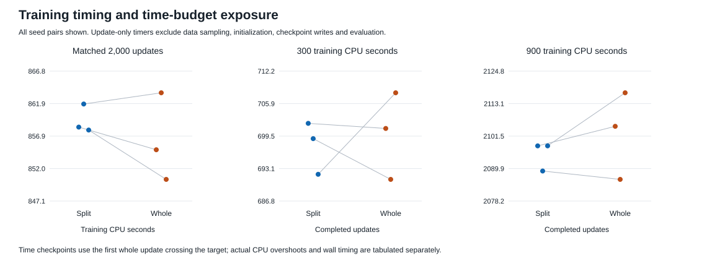

# Two local loops versus one long loop

**Complete standard evaluation:** all six completed runs and all 18 evaluated checkpoints passed identity checks. Training/evaluation used r=2.

## Question and architecture

This is a controlled recurrent-order NAT pilot, inspired by the layer-count motif in NVIDIA Dory. It does not use a Dory checkpoint and is not a Dory architecture replication. The unique blocks are 8 input + 20 middle + 8 output. A is the first ordered ten-block middle group, B the second. Split executes I A^r B^r O; whole executes I (AB)^r O. At the training count r=2, these are I A A B B O versus I A B A B O: 56 block applications and 764,304 unique trainable parameters in either arm. Width 48, four heads, FFN hidden width 117, RMSNorm and RoPE are used. There is no input reinjection, activation checkpointing or truncated backward. nGPT, Dory tokenizer/weights, hybrid attention, pretraining and KV caching are not reproduced.

## Objective and target isolation

Each example provides a 96-byte prefix plus 32 MASK slots. A single network call predicts all 32 suffix bytes in parallel using bidirectional attention; the loss is suffix-only cross entropy. Gold target bytes never enter the model inputs and there is no target-token feedback between layers or loops. Internal recurrence is latent computation, not autoregressive decoding. Parameters are counted once despite repeated middle-layer applications.

## Training and two estimands

Three paired seeds (1, 2, 3) have identical within-seed initialization and deterministic batch streams across arms. Training uses batch 8, AdamW, fixed base learning rate 0.0005, 100-step linear warmup then constant rate, matrix weight decay 0.01, no norm-vector decay and gradient clipping at 1. The learning rate is a common untuned pilot choice. Matched 2,000 updates means 512,000 supervised suffix-byte presentations per run and matched nominal block-operation counts. The separate 300- and 900-training-CPU-second comparisons stop at the first full update crossing each target and can expose the arms to different stream-prefix lengths. CPU overshoot and actual update counts are reported. No checkpoint was selected using validation or test outcomes.

## Evaluation and reused cohorts

Each of the 18 checkpoints is evaluated at r=2 on 256 validation windows, all 10,059 eligible nonoverlapping article-contained WikiText-2 test windows, and 2,134 windows from the existing 100-document FineWeb source cohort. Exact 128-byte training-window matches and duplicate windows are excluded by the pinned loader; matching 32-byte targets are counted in the manifests, not excluded. These cohorts were reused from earlier studies and are not newly held-out evidence for the wider research program. The saved FineWeb new_to_this_nat_comparison field is loader metadata, not a claim of a newly collected cohort. Test and FineWeb are reported separately; validation is descriptive only. Metrics weight equal-length windows/bytes, not documents equally. No raw corpus text is included in this report.

## Uncertainty and limits

Every component and paired seed difference is shown. Summary means, sample SD (denominator n−1), and observed minimum–maximum describe these three fitted seed pairs only. The reported uncertainty is not an architecture-population confidence interval, hypothesis test or evidence of convergence. No document bootstrap is performed. No weighted or invented composite score is used, and no best checkpoint/count is selected. Reused cohorts, only three seeds, an untuned common learning rate, small byte-level models and a narrow completion task limit interpretation. This pilot cannot establish general intelligence, 600B-model equivalence, GPU speed/efficiency, large-model scaling or NVIDIA Dory performance.

## Timing scope

Training CPU and training wall values sum timed updates only: zero-grad, forward/loss, backward, clipping and AdamW. Sampling, initialization, checkpoint serialization and evaluation are excluded. Training wall is not total end-to-end process wall. Evaluation wall is recorded separately and includes loading/setting up the held-out cohorts and checkpoint evaluations after model construction. End-to-end training process wall is not recorded in these receipts. Sequential one-core/one-thread CPU FP32 measurements are descriptive, not repeated microbenchmarks, FLOP measurements or GPU forecasts. Runs continue until both 2,000 updates and 900 CPU seconds are met, so final-run timing is not the matched-update budget.

## Separate inference-count sweep

The prepared sweep evaluates every integer r=0…100 using the six matched-update checkpoints trained only at r=2. It is inference-count extrapolation, not retraining at 101 counts. Total block applications are 16+20r; at r=0 the 16 outer blocks still execute and can condition on the prefix, with 353,424 invoked module parameters while 764,304 remain stored. This standard-checkpoint report does not load, summarize or claim completion of the sweep. Use report_sweep.py and its separate runtime-selected cohort protocol/report for that experiment.

## Matched 2,000 updates: component summaries

| Domain | Metric | Split mean ± SD | Whole mean ± SD | Split−whole mean ± SD | Paired seed range |
| --- | --- | --- | --- | --- | --- |
| WikiText-2 test | Suffix bits/byte (bpb) | 4.57376 ± 0.00487 | 4.57228 ± 0.00302 | 0.00148 ± 0.00187 | [-0.00062, 0.00296] |
| WikiText-2 test | Byte accuracy (%; delta pp) | 18.95628 ± 0.00000 | 18.95628 ± 0.00000 | 0.00000 ± 0.00000 | [0.00000, 0.00000] |
| WikiText-2 test | Exact 32-byte match (%; delta pp) | 0.00000 ± 0.00000 | 0.00000 ± 0.00000 | 0.00000 ± 0.00000 | [0.00000, 0.00000] |
| FineWeb cohort | Suffix bits/byte (bpb) | 4.58043 ± 0.00219 | 4.57926 ± 0.00242 | 0.00117 ± 0.00284 | [-0.00051, 0.00445] |
| FineWeb cohort | Byte accuracy (%; delta pp) | 15.95156 ± 0.00000 | 15.95156 ± 0.00000 | 0.00000 ± 0.00000 | [0.00000, 0.00000] |
| FineWeb cohort | Exact 32-byte match (%; delta pp) | 0.00000 ± 0.00000 | 0.00000 ± 0.00000 | 0.00000 ± 0.00000 | [0.00000, 0.00000] |
| WikiText-2 validation | Suffix bits/byte (bpb) | 4.55039 ± 0.00701 | 4.55012 ± 0.00339 | 0.00027 ± 0.00364 | [-0.00348, 0.00379] |
| WikiText-2 validation | Byte accuracy (%; delta pp) | 18.99414 ± 0.00000 | 18.99414 ± 0.00000 | 0.00000 ± 0.00000 | [0.00000, 0.00000] |
| WikiText-2 validation | Exact 32-byte match (%; delta pp) | 0.00000 ± 0.00000 | 0.00000 ± 0.00000 | 0.00000 ± 0.00000 | [0.00000, 0.00000] |

## Matched 2,000 updates: all seeds

| Domain | Arm | Seed | Suffix bpb | Byte accuracy % | Exact match % |
| --- | --- | --- | --- | --- | --- |
| WikiText-2 test | split | 1 | 4.574749 | 18.95628 | 0.00000 |
| WikiText-2 test | whole | 1 | 4.572657 | 18.95628 | 0.00000 |
| WikiText-2 test | split | 2 | 4.578054 | 18.95628 | 0.00000 |
| WikiText-2 test | whole | 2 | 4.575097 | 18.95628 | 0.00000 |
| WikiText-2 test | split | 3 | 4.568472 | 18.95628 | 0.00000 |
| WikiText-2 test | whole | 3 | 4.569093 | 18.95628 | 0.00000 |
| FineWeb cohort | split | 1 | 4.581559 | 15.95156 | 0.00000 |
| FineWeb cohort | whole | 1 | 4.581990 | 15.95156 | 0.00000 |
| FineWeb cohort | split | 2 | 4.581830 | 15.95156 | 0.00000 |
| FineWeb cohort | whole | 2 | 4.577381 | 15.95156 | 0.00000 |
| FineWeb cohort | split | 3 | 4.577906 | 15.95156 | 0.00000 |
| FineWeb cohort | whole | 3 | 4.578416 | 15.95156 | 0.00000 |
| WikiText-2 validation | split | 1 | 4.551279 | 18.99414 | 0.00000 |
| WikiText-2 validation | whole | 1 | 4.550782 | 18.99414 | 0.00000 |
| WikiText-2 validation | split | 2 | 4.556916 | 18.99414 | 0.00000 |
| WikiText-2 validation | whole | 2 | 4.553128 | 18.99414 | 0.00000 |
| WikiText-2 validation | split | 3 | 4.542978 | 18.99414 | 0.00000 |
| WikiText-2 validation | whole | 3 | 4.546453 | 18.99414 | 0.00000 |

## Matched 2,000 updates: paired seed differences (split minus whole)

| Domain | Seed | Suffix bpb difference | Byte accuracy difference, pp | Exact match difference, pp |
| --- | --- | --- | --- | --- |
| WikiText-2 test | 1 | +0.002092 | +0.00000 | +0.00000 |
| WikiText-2 test | 2 | +0.002957 | +0.00000 | +0.00000 |
| WikiText-2 test | 3 | -0.000621 | +0.00000 | +0.00000 |
| FineWeb cohort | 1 | -0.000431 | +0.00000 | +0.00000 |
| FineWeb cohort | 2 | +0.004449 | +0.00000 | +0.00000 |
| FineWeb cohort | 3 | -0.000510 | +0.00000 | +0.00000 |
| WikiText-2 validation | 1 | +0.000498 | +0.00000 | +0.00000 |
| WikiText-2 validation | 2 | +0.003787 | +0.00000 | +0.00000 |
| WikiText-2 validation | 3 | -0.003475 | +0.00000 | +0.00000 |

## 300 training CPU seconds: component summaries

| Domain | Metric | Split mean ± SD | Whole mean ± SD | Split−whole mean ± SD | Paired seed range |
| --- | --- | --- | --- | --- | --- |
| WikiText-2 test | Suffix bits/byte (bpb) | 4.58778 ± 0.00144 | 4.58899 ± 0.00131 | -0.00121 ± 0.00172 | [-0.00302, 0.00040] |
| WikiText-2 test | Byte accuracy (%; delta pp) | 18.95628 ± 0.00000 | 18.95628 ± 0.00000 | 0.00000 ± 0.00000 | [0.00000, 0.00000] |
| WikiText-2 test | Exact 32-byte match (%; delta pp) | 0.00000 ± 0.00000 | 0.00000 ± 0.00000 | 0.00000 ± 0.00000 | [0.00000, 0.00000] |
| FineWeb cohort | Suffix bits/byte (bpb) | 4.58861 ± 0.00349 | 4.58825 ± 0.00283 | 0.00036 ± 0.00375 | [-0.00370, 0.00371] |
| FineWeb cohort | Byte accuracy (%; delta pp) | 15.95156 ± 0.00000 | 15.95156 ± 0.00000 | 0.00000 ± 0.00000 | [0.00000, 0.00000] |
| FineWeb cohort | Exact 32-byte match (%; delta pp) | 0.00000 ± 0.00000 | 0.00000 ± 0.00000 | 0.00000 ± 0.00000 | [0.00000, 0.00000] |
| WikiText-2 validation | Suffix bits/byte (bpb) | 4.55979 ± 0.00266 | 4.56228 ± 0.00193 | -0.00249 ± 0.00268 | [-0.00498, 0.00035] |
| WikiText-2 validation | Byte accuracy (%; delta pp) | 18.99414 ± 0.00000 | 18.99414 ± 0.00000 | 0.00000 ± 0.00000 | [0.00000, 0.00000] |
| WikiText-2 validation | Exact 32-byte match (%; delta pp) | 0.00000 ± 0.00000 | 0.00000 ± 0.00000 | 0.00000 ± 0.00000 | [0.00000, 0.00000] |

## 300 training CPU seconds: all seeds

| Domain | Arm | Seed | Suffix bpb | Byte accuracy % | Exact match % |
| --- | --- | --- | --- | --- | --- |
| WikiText-2 test | split | 1 | 4.589400 | 18.95628 | 0.00000 |
| WikiText-2 test | whole | 1 | 4.588998 | 18.95628 | 0.00000 |
| WikiText-2 test | split | 2 | 4.587285 | 18.95628 | 0.00000 |
| WikiText-2 test | whole | 2 | 4.590303 | 18.95628 | 0.00000 |
| WikiText-2 test | split | 3 | 4.586655 | 18.95628 | 0.00000 |
| WikiText-2 test | whole | 3 | 4.587675 | 18.95628 | 0.00000 |
| FineWeb cohort | split | 1 | 4.591928 | 15.95156 | 0.00000 |
| FineWeb cohort | whole | 1 | 4.590849 | 15.95156 | 0.00000 |
| FineWeb cohort | split | 2 | 4.584974 | 15.95156 | 0.00000 |
| FineWeb cohort | whole | 2 | 4.588672 | 15.95156 | 0.00000 |
| FineWeb cohort | split | 3 | 4.588941 | 15.95156 | 0.00000 |
| FineWeb cohort | whole | 3 | 4.585232 | 15.95156 | 0.00000 |
| WikiText-2 validation | split | 1 | 4.562697 | 18.99414 | 0.00000 |
| WikiText-2 validation | whole | 1 | 4.562342 | 18.99414 | 0.00000 |
| WikiText-2 validation | split | 2 | 4.559200 | 18.99414 | 0.00000 |
| WikiText-2 validation | whole | 2 | 4.564176 | 18.99414 | 0.00000 |
| WikiText-2 validation | split | 3 | 4.557466 | 18.99414 | 0.00000 |
| WikiText-2 validation | whole | 3 | 4.560323 | 18.99414 | 0.00000 |

## 300 training CPU seconds: paired seed differences (split minus whole)

| Domain | Seed | Suffix bpb difference | Byte accuracy difference, pp | Exact match difference, pp |
| --- | --- | --- | --- | --- |
| WikiText-2 test | 1 | +0.000402 | +0.00000 | +0.00000 |
| WikiText-2 test | 2 | -0.003018 | +0.00000 | +0.00000 |
| WikiText-2 test | 3 | -0.001020 | +0.00000 | +0.00000 |
| FineWeb cohort | 1 | +0.001079 | +0.00000 | +0.00000 |
| FineWeb cohort | 2 | -0.003698 | +0.00000 | +0.00000 |
| FineWeb cohort | 3 | +0.003709 | +0.00000 | +0.00000 |
| WikiText-2 validation | 1 | +0.000355 | +0.00000 | +0.00000 |
| WikiText-2 validation | 2 | -0.004976 | +0.00000 | +0.00000 |
| WikiText-2 validation | 3 | -0.002857 | +0.00000 | +0.00000 |

## 900 training CPU seconds: component summaries

| Domain | Metric | Split mean ± SD | Whole mean ± SD | Split−whole mean ± SD | Paired seed range |
| --- | --- | --- | --- | --- | --- |
| WikiText-2 test | Suffix bits/byte (bpb) | 4.57655 ± 0.00275 | 4.57320 ± 0.00129 | 0.00334 ± 0.00179 | [0.00142, 0.00496] |
| WikiText-2 test | Byte accuracy (%; delta pp) | 18.95628 ± 0.00000 | 18.95628 ± 0.00000 | 0.00000 ± 0.00000 | [0.00000, 0.00000] |
| WikiText-2 test | Exact 32-byte match (%; delta pp) | 0.00000 ± 0.00000 | 0.00000 ± 0.00000 | 0.00000 ± 0.00000 | [0.00000, 0.00000] |
| FineWeb cohort | Suffix bits/byte (bpb) | 4.58354 ± 0.00857 | 4.58530 ± 0.00334 | -0.00176 ± 0.00526 | [-0.00583, 0.00418] |
| FineWeb cohort | Byte accuracy (%; delta pp) | 15.95156 ± 0.00000 | 15.95156 ± 0.00000 | 0.00000 ± 0.00000 | [0.00000, 0.00000] |
| FineWeb cohort | Exact 32-byte match (%; delta pp) | 0.00000 ± 0.00000 | 0.00000 ± 0.00000 | 0.00000 ± 0.00000 | [0.00000, 0.00000] |
| WikiText-2 validation | Suffix bits/byte (bpb) | 4.55423 ± 0.00664 | 4.55189 ± 0.00483 | 0.00234 ± 0.00186 | [0.00035, 0.00405] |
| WikiText-2 validation | Byte accuracy (%; delta pp) | 18.99414 ± 0.00000 | 18.99414 ± 0.00000 | 0.00000 ± 0.00000 | [0.00000, 0.00000] |
| WikiText-2 validation | Exact 32-byte match (%; delta pp) | 0.00000 ± 0.00000 | 0.00000 ± 0.00000 | 0.00000 ± 0.00000 | [0.00000, 0.00000] |

## 900 training CPU seconds: all seeds

| Domain | Arm | Seed | Suffix bpb | Byte accuracy % | Exact match % |
| --- | --- | --- | --- | --- | --- |
| WikiText-2 test | split | 1 | 4.574250 | 18.95628 | 0.00000 |
| WikiText-2 test | whole | 1 | 4.572826 | 18.95628 | 0.00000 |
| WikiText-2 test | split | 2 | 4.579593 | 18.95628 | 0.00000 |
| WikiText-2 test | whole | 2 | 4.574635 | 18.95628 | 0.00000 |
| WikiText-2 test | split | 3 | 4.575793 | 18.95628 | 0.00000 |
| WikiText-2 test | whole | 3 | 4.572145 | 18.95628 | 0.00000 |
| FineWeb cohort | split | 1 | 4.579902 | 15.95156 | 0.00000 |
| FineWeb cohort | whole | 1 | 4.583547 | 15.95156 | 0.00000 |
| FineWeb cohort | split | 2 | 4.593329 | 15.95156 | 0.00000 |
| FineWeb cohort | whole | 2 | 4.589150 | 15.95156 | 0.00000 |
| FineWeb cohort | split | 3 | 4.577384 | 15.95156 | 0.00000 |
| FineWeb cohort | whole | 3 | 4.583211 | 15.95156 | 0.00000 |
| WikiText-2 validation | split | 1 | 4.553642 | 18.99414 | 0.00000 |
| WikiText-2 validation | whole | 1 | 4.551008 | 18.99414 | 0.00000 |
| WikiText-2 validation | split | 2 | 4.561143 | 18.99414 | 0.00000 |
| WikiText-2 validation | whole | 2 | 4.557097 | 18.99414 | 0.00000 |
| WikiText-2 validation | split | 3 | 4.547910 | 18.99414 | 0.00000 |
| WikiText-2 validation | whole | 3 | 4.547560 | 18.99414 | 0.00000 |

## 900 training CPU seconds: paired seed differences (split minus whole)

| Domain | Seed | Suffix bpb difference | Byte accuracy difference, pp | Exact match difference, pp |
| --- | --- | --- | --- | --- |
| WikiText-2 test | 1 | +0.001424 | +0.00000 | +0.00000 |
| WikiText-2 test | 2 | +0.004959 | +0.00000 | +0.00000 |
| WikiText-2 test | 3 | +0.003648 | +0.00000 | +0.00000 |
| FineWeb cohort | 1 | -0.003645 | +0.00000 | +0.00000 |
| FineWeb cohort | 2 | +0.004179 | +0.00000 | +0.00000 |
| FineWeb cohort | 3 | -0.005826 | +0.00000 | +0.00000 |
| WikiText-2 validation | 1 | +0.002635 | +0.00000 | +0.00000 |
| WikiText-2 validation | 2 | +0.004045 | +0.00000 | +0.00000 |
| WikiText-2 validation | 3 | +0.000350 | +0.00000 | +0.00000 |

## Training checkpoint timing and exposure

| Checkpoint | Arm | Seed | Updates | Update CPU s | Update wall s | CPU overshoot s | Suffix-byte presentations |
| --- | --- | --- | --- | --- | --- | --- | --- |
| Matched 2,000 updates | split | 1 | 2000 | 858.293873 | 858.358673 | N/A | 512000 |
| Matched 2,000 updates | whole | 1 | 2000 | 854.855544 | 854.908956 | N/A | 512000 |
| Matched 2,000 updates | split | 2 | 2000 | 861.796280 | 861.874893 | N/A | 512000 |
| Matched 2,000 updates | whole | 2 | 2000 | 863.497500 | 863.548875 | N/A | 512000 |
| Matched 2,000 updates | split | 3 | 2000 | 857.848658 | 857.960798 | N/A | 512000 |
| Matched 2,000 updates | whole | 3 | 2000 | 850.360117 | 850.405736 | N/A | 512000 |
| 300 training CPU seconds | split | 1 | 702 | 300.238280 | 300.279304 | 0.238280 | 179712 |
| 300 training CPU seconds | whole | 1 | 701 | 300.175963 | 300.198236 | 0.175963 | 179456 |
| 300 training CPU seconds | split | 2 | 699 | 300.361936 | 300.392058 | 0.361936 | 178944 |
| 300 training CPU seconds | whole | 2 | 691 | 300.288849 | 300.309932 | 0.288849 | 176896 |
| 300 training CPU seconds | split | 3 | 692 | 300.186480 | 300.227762 | 0.186480 | 177152 |
| 300 training CPU seconds | whole | 3 | 708 | 300.384154 | 300.408345 | 0.384154 | 181248 |
| 900 training CPU seconds | split | 1 | 2098 | 900.233743 | 900.300071 | 0.233743 | 537088 |
| 900 training CPU seconds | whole | 1 | 2105 | 900.237369 | 900.292459 | 0.237369 | 538880 |
| 900 training CPU seconds | split | 2 | 2089 | 900.352523 | 900.432538 | 0.352523 | 534784 |
| 900 training CPU seconds | whole | 2 | 2086 | 900.129709 | 900.183105 | 0.129709 | 534016 |
| 900 training CPU seconds | split | 3 | 2098 | 900.038323 | 900.155093 | 0.038323 | 537088 |
| 900 training CPU seconds | whole | 3 | 2117 | 900.142539 | 900.190780 | 0.142539 | 541952 |

## Full-run receipts, separate from checkpoint budgets

| Arm | Seed | Final updates | Update CPU s | Update wall s | Evaluation wall s | Peak RSS KiB |
| --- | --- | --- | --- | --- | --- | --- |
| split | 1 | 2098 | 900.233743 | 900.300071 | 686.547252 | 685852 |
| whole | 1 | 2105 | 900.237369 | 900.292459 | 605.582642 | 685904 |
| split | 2 | 2089 | 900.352523 | 900.432538 | 603.258674 | 686660 |
| whole | 2 | 2086 | 900.129709 | 900.183105 | 602.796205 | 685848 |
| split | 3 | 2098 | 900.038323 | 900.155093 | 611.682700 | 684940 |
| whole | 3 | 2117 | 900.142539 | 900.190780 | 604.144553 | 689996 |

## Evaluation selection identity

| Domain | Windows | Documents | Selection SHA-256 |
| --- | --- | --- | --- |
| WikiText-2 test | 10059 | 61 | e4186c505f4df78b759a2cfab8f9aaee6911f02819efdc9449f4a1e113e91cce |
| FineWeb cohort | 2134 | 100 | d07e6bee30f4f604675f9a9bda41b66b729acd3371e37661080aadc969a032f7 |
| WikiText-2 validation | 256 | 60 | c474f1d4b25cb3152f09c3480e82bc5d39f36a596aa6020681340814357344f7 |

## Reproducibility and files

All six completion receipts, 18 checkpoint byte hashes, frozen source files, paired initialization and equal-step data hashes, and identical evaluation selections/document order verified. No models or corpus text loaded. Initialization and batch-stream hashes are checked against saved receipts, not reconstructed by training; evaluation selection hashes are compared, not recomputed from raw corpus text.

Generator SHA-256: 92be203c0432833403fa738f0a2b85e5b293366f100e921370445fabb4ab4423

Machine-readable tables: components.csv/json, paired_differences.csv/json, summary.csv/json, checkpoint_timing.csv/json, timing_summary.csv/json and run_timing.csv/json. provenance.json records source/input/checkpoint identities; artifact_hashes.json records generated files. No corpus text or model tensors are embedded.

Architectural motivation: https://huggingface.co/nvidia/NVIDIA-Nemotron-Labs-Dory1.0-4B-BF16/blob/main/README.md (previously inspected November 11, 2026; displayed revision b366b87).

