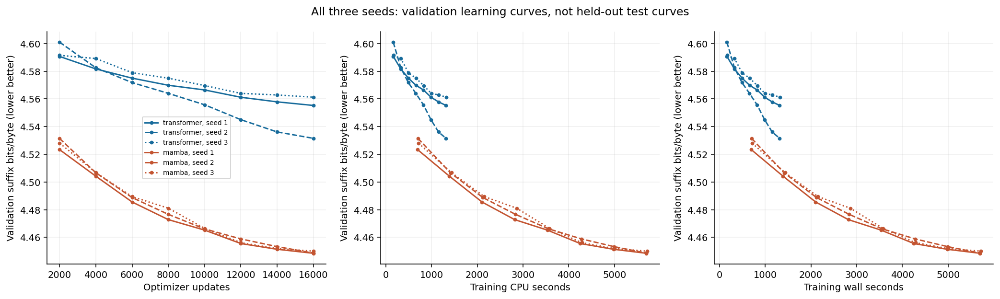
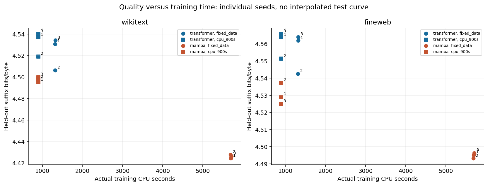
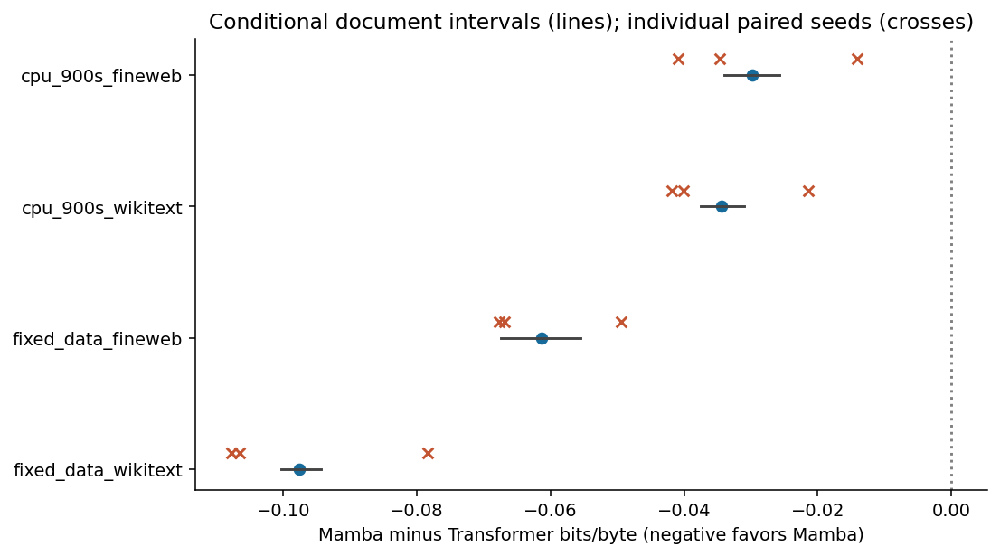
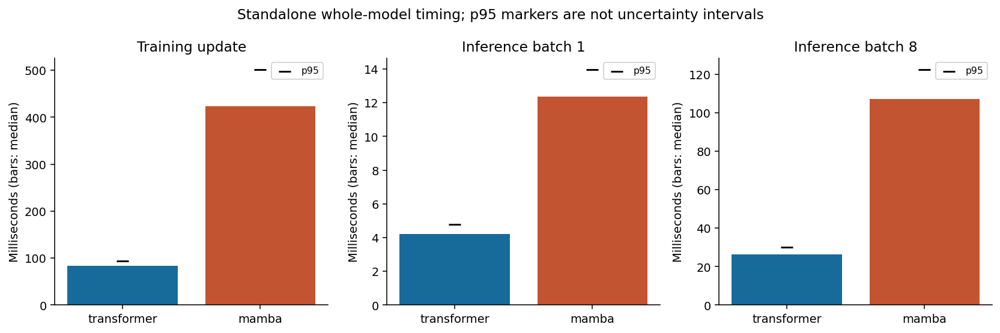
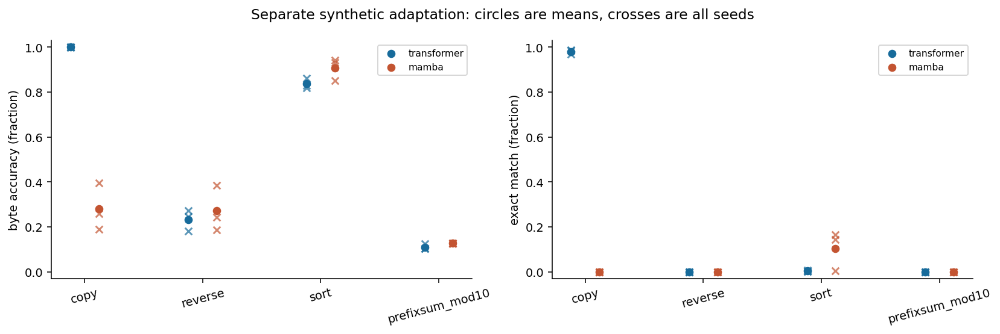

# Single-pass NAT: Transformer versus optimized bidirectional Mamba-1

## Scope and design

Three-layer width-128 FP32 models: Transformer 765,568 parameters; Mamba 765,184. Fixed 96-byte prefix and 32 fully blanked suffix positions. One forward pass predicts all suffix bytes independently conditional on the prefix. This is neither diffusion nor autoregressive generation.

Matched-data fits: 16,000 updates × batch 8 × 32 targets = 4,096,000 supervised target presentations per seed. Seeds: [1, 2, 3]. Data order and common embedding/output initialization hashes are paired; architecture-specific weights differ.

Text-only primary training differs from the earlier mixed-task pilot, so pilot differences cannot be attributed solely to scale or scan optimization.

Learning-rate grid [0.0005, 0.0015, 0.0045]; selected {'transformer': 0.0005, 'mamba': 0.0005}. Both selections are at the lowest tested boundary (0.0005), so this search does not locate an optimum. Selection uses 1,000-step seed-101 validation only, with the same 16,000-step schedule prefix.

## Test quality

All numbers below are across-seed mean ± sample SD, not a confidence interval. Bits/byte is conditional suffix cross-entropy, not autoregressive full-text likelihood. Byte accuracy and 32-byte exact-match are fractions.

### fixed_data

- transformer / wikitext: bits/byte 4.52375 ± 0.01527; byte accuracy 0.19091 ± 0.00201; exact-match 0.00000 ± 0.00000.

- transformer / fineweb: bits/byte 4.55620 ± 0.01185; byte accuracy 0.16072 ± 0.00208; exact-match 0.00000 ± 0.00000.

- mamba / wikitext: bits/byte 4.42619 ± 0.00173; byte accuracy 0.20487 ± 0.00028; exact-match 0.00000 ± 0.00000.

- mamba / fineweb: bits/byte 4.49487 ± 0.00161; byte accuracy 0.17299 ± 0.00030; exact-match 0.00000 ± 0.00000.

### cpu_900s

- transformer / wikitext: bits/byte 4.53202 ± 0.01124; byte accuracy 0.19035 ± 0.00124; exact-match 0.00000 ± 0.00000.

- transformer / fineweb: bits/byte 4.56030 ± 0.00780; byte accuracy 0.16024 ± 0.00125; exact-match 0.00000 ± 0.00000.

- mamba / wikitext: bits/byte 4.49756 ± 0.00236; byte accuracy 0.19849 ± 0.00008; exact-match 0.00000 ± 0.00000.

- mamba / fineweb: bits/byte 4.53047 ± 0.00632; byte accuracy 0.16824 ± 0.00063; exact-match 0.00000 ± 0.00000.

### separate_task_adaptation

Separate 2,000-update adaptation on balanced-in-expectation synthetic tasks, LR 0.001; 1,024 unseen inputs per task. Text-only checkpoints are preserved. This measures task adaptation, not zero-shot capability or general intelligence. Uniform digit guesses have 10% expected byte accuracy. Merely copying the input unchanged gives 12.8125% expected byte accuracy on prefix-sum modulo 10 (the first byte is always correct, the other 31 match with probability 0.1). A score near that shortcut baseline is not evidence of cumulative arithmetic; exact 32-byte match is also reported.

- transformer / copy: bits/byte 0.00604 ± 0.00252; byte accuracy 0.99931 ± 0.00027; exact-match 0.97982 ± 0.00963.

- transformer / reverse: bits/byte 3.00238 ± 0.15013; byte accuracy 0.23237 ± 0.04701; exact-match 0.00000 ± 0.00000.

- transformer / sort: bits/byte 0.55248 ± 0.06567; byte accuracy 0.83677 ± 0.02321; exact-match 0.00326 ± 0.00314.

- transformer / prefixsum_mod10: bits/byte 3.31826 ± 0.02912; byte accuracy 0.10975 ± 0.01244; exact-match 0.00000 ± 0.00000.

- mamba / copy: bits/byte 2.75046 ± 0.46582; byte accuracy 0.28119 ± 0.10501; exact-match 0.00000 ± 0.00000.

- mamba / reverse: bits/byte 2.79831 ± 0.44716; byte accuracy 0.27070 ± 0.10169; exact-match 0.00000 ± 0.00000.

- mamba / sort: bits/byte 0.33669 ± 0.18388; byte accuracy 0.90788 ± 0.04983; exact-match 0.10449 ± 0.08783.

- mamba / prefixsum_mod10: bits/byte 3.23170 ± 0.00685; byte accuracy 0.12686 ± 0.00159; exact-match 0.00000 ± 0.00000.

## Matched-time interpretation and uncertainty

900-second checkpoints are the first whole update crossing 900 training CPU seconds. Overshoot and update counts are reported below. Training-update CPU and wall measurements include forward, loss, backward, gradient clipping and optimizer work, but exclude batch generation and hashing, logging, validation, checkpoint saving, and compilation. CPU time also excludes waiting. These are training-update compute measurements, not end-to-end elapsed time. End-to-end text wall time is reported separately. Missing threshold checkpoints are never replaced by final checkpoints. 300-second snapshots are archival only, not a planned held-out comparison here.

The document bootstrap averages the three fitted seeds first, then resamples paired documents 5,000 times with target-count weighting. Its 95% intervals are conditional on those fitted seeds and observed cohorts. Across-seed SD and paired seed differences are separate; neither establishes general population or architectural uncertainty. Comparisons beyond the primary endpoint are exploratory.

- transformer: 900-second steps [10926, 10943, 10876]; actual CPU seconds [900.0612733560005, 900.0036526700028, 900.0056958999994].

- mamba: 900-second steps [2588, 2549, 2513]; actual CPU seconds [900.2337319270009, 900.1898143290008, 900.3187130510022].

- fixed_data_wikitext: Mamba − Transformer = -0.09756 bits/byte, conditional document 95% interval [-0.10036465422251485, -0.09440164616016616]; 61 documents; paired seed means [-0.10648837615145927, -0.07841547379451923, -0.10778118996420794].

- fixed_data_fineweb: Mamba − Transformer = -0.06133 bits/byte, conditional document 95% interval [-0.06744990925051121, -0.05552625194485175]; 100 documents; paired seed means [-0.06688524761165049, -0.04939828571016665, -0.06771555551132796].

- cpu_900s_wikitext: Mamba − Transformer = -0.03446 bits/byte, conditional document 95% interval [-0.037544711332477734, -0.03106656320512236]; 61 documents; paired seed means [-0.041786213932427665, -0.021472838973755133, -0.040127116670897564].

- cpu_900s_fineweb: Mamba − Transformer = -0.02984 bits/byte, conditional document 95% interval [-0.03401129418014815, -0.02574964695601721]; 100 documents; paired seed means [-0.034619219337156754, -0.014038803560403186, -0.040851367389958225].

## Baselines and conditioning

Training-byte unigram baseline (half-count smoothing): {'wikitext': 4.57690231003572, 'fineweb': 4.581922464002306} bits/byte.

- transformer: shuffled-prefix minus real-prefix bits/byte 0.08243 ± 0.02921 on 2,048 fixed WikiText test windows. Positive means the real prefix helps. Rotation can retain same-document context; this is a diagnostic, not an independent causal test.

- mamba: shuffled-prefix minus real-prefix bits/byte 0.29795 ± 0.00527 on 2,048 fixed WikiText test windows. Positive means the real prefix helps. Rotation can retain same-document context; this is a diagnostic, not an independent causal test.

## Active-compute accounting (partial static estimate)

Matching parameter counts is not matching compute. At batch 1, sequence length 128, width 128, three layers and 32 output positions:

- Transformer matrix MACs: 103,088,128. Formula: 3*(128*(4*128^2+2*128*654)+2*128^2*128)+32*128*256.

- Bidirectional Mamba matrix/convolution MACs: 86,788,096. Formula: 3*2*(128*(128*512+256*40+8*256+256*128)+131*256*4)+32*128*256.

The Mamba depthwise convolution produces 131 positions with padding before truncation to 128; the partial total includes the 18,432 nominal MACs for those discarded positions across all branches/layers.

- Mamba state elements updated per forward: 3,145,728. Formula: 3*2*128*256*16. This is a separate state-element count, not MACs or FLOPs.

The partial MAC totals omit normalization, activations, RoPE, softmax, the selective scan recurrence and other pointwise operations. They also omit backward/optimizer work, memory movement and dispatch. One MAC means one multiply-accumulate; these are not complete FLOP totals. Do not infer equal FLOPs or less total work for Mamba.

Both dense arms invoke all layer modules; embedding lookup uses indexed rows, and neither arm has an expert router. Interpret these partial estimates alongside measured whole-model runtime below.

## Timing and memory

AMD EPYC9V74 shared cloud CPU, 1 pinned thread

Standalone serial paired order after training. Training uses throwaway model copies initialized from seed1 final checkpoint, five optimizer warmup steps, no saved checkpoint altered. Inference follows those bounded throwaway steps, so it is a shape/runtime benchmark rather than quality evaluation.

Training timings from concurrent pinned runs and serial standalone throughput are different measurements.

- transformer training_cpu_seconds: 1319.17064 ± 3.92762.

- transformer training_wall_seconds: 1319.26961 ± 3.99675.

- transformer end_to_end_text_wall_seconds: 1352.11435 ± 3.90530.

- transformer task_training_cpu_seconds: 168.51853 ± 2.94221.

- transformer peak_rss_kib: 426180.00000 ± 1348.87212.

- transformer compiler/cache-load seconds by seed: [0.00021803900017403066, 0.0002670030007720925, 0.0002667820008355193]

- transformer standalone training p50/p95: 84.037/93.973 ms; 3046.3 supervised target bytes/s.

- transformer standalone inference batch 1 p50/p95: 4.200/4.764 ms.

- transformer standalone inference batch 8 p50/p95: 26.294/30.148 ms.

- mamba training_cpu_seconds: 5699.88533 ± 9.77645.

- mamba training_wall_seconds: 5700.68211 ± 9.95992.

- mamba end_to_end_text_wall_seconds: 5819.29247 ± 12.85887.

- mamba task_training_cpu_seconds: 710.82269 ± 3.19645.

- mamba peak_rss_kib: 1346562.66667 ± 10343.53157.

- mamba compiler/cache-load seconds by seed: [0.00022101300055510364, 0.00023227099882205948, 0.00023246100317919627]

- mamba standalone training p50/p95: 423.937/500.922 ms; 603.9 supervised target bytes/s.

- mamba standalone inference batch 1 p50/p95: 12.347/13.951 ms.

- mamba standalone inference batch 8 p50/p95: 107.170/122.270 ms.

Standalone training Transformer/Mamba p50 ratio: 0.198. Greater than one means Mamba faster.

Standalone benchmark process peak RSS: 1285136 KiB, combined high-water mark, not per-architecture memory.

## Resource accounting and monetary limits

Measured update CPU seconds: final text 21057.168; separate task adaptation 2638.024; tuning 1289.9941519599993. Total measured update core-hours: 6.9403293747466455.

Whole training-pipeline elapsed wall seconds: 15545.310923857. This includes overlapping pinned jobs and must not be added to their CPU seconds.

Measured training-update CPU time only; excludes preparation, validation/testing, saving, compilation, reporting and backup. Pipeline elapsed wall time includes concurrent jobs and is not summed CPU time.

Not measured. No rental or purchase action was made for this experiment. Existing platform billing is not inferred.

These measurements do not establish dollar cost per successful task, dollar savings, or a 600B-scale cost projection. Runtime and quality are reported separately rather than combined into an invented intelligence or value score.

## Optimization provenance

Mamba architecture/initialization reference: Tri Dao and Albert Gu, state-spaces/mamba commit e9594ce1c732d97440f0332fdc43170a2294dbfa, Apache License 2.0. This is an independent implementation. Private user-owned AGILLM source informed context but is not redistributed. See THIRD_PARTY_NOTICES.md.

Custom native C++ affine recurrence and first-order backward replace the generic PyTorch scan with linear work. FP32/FP64 CPU parity, gradients and AdamW-update tests were checked; no official fused GPU Mamba-2 kernel is used.

- MambaDirection block microbenchmark B=16, T=48, width=48, state=8: 1.944× over prior generic parallel scan. This is not a whole-model speedup or a Transformer comparison.

- MambaDirection block microbenchmark B=16, T=128, width=128, state=16: 5.624× over prior generic parallel scan. This is not a whole-model speedup or a Transformer comparison.

- Separate complete-model scan upgrade: 4.725× training-step speedup for the same 765,184-parameter bidirectional Mamba, batch 8, length 128, CPU FP32. Median native-linear / generic-parallel step seconds: 0.463370 / 2.189442. Two warm-up steps, seven randomized paired trials; only the scan changes. This is not a Transformer comparison.

  First-step maximum absolute differences: {'logits': 5.7220458984375e-06, 'gradients': 5.4016709327697754e-08, 'updated_parameters': 3.5688281059265137e-06}. Gradients are compared after common norm-1 clipping. Both copies use identical final seed-1 weights and fresh AdamW states. Forward, backward and updated parameters pass the recorded FP32 tolerances, not bitwise equality. No saved checkpoint is modified.

Cold compile 0.3911s; first use 0.3921s, excluded from steady-state block timing.

## Corpus provenance and exclusions

WikiText: Salesforce/wikitext, wikitext-2-raw-v1, revision b08601e04326c79dfdd32d625aee71d232d685c3. UTF-8 LF-joined original rows; 10,951,562 training bytes. Previously inspected metadata for this same pinned dataset reports CC-BY-SA-3.0 and GFDL; other licensing prose links CC-BY-SA-4.0. Preserve the original-source rights and this unresolved licensing inconsistency; see THIRD_PARTY_NOTICES.md. Corpus content is not included in these deliverables.

Training samples uniform valid article-contained 128-byte windows; windows crossing article boundaries and short documents are ineligible. Evaluation uses nonoverlapping article-contained windows, excludes exact 128-byte training/duplicate windows, and retains/report counts of 32-byte target overlaps.

FineWeb-Edu: HuggingFaceFW/fineweb-edu revision 87f09149ef4734204d70ed1d046ddc9ca3f2b8f9, rows 1500–1599, each document truncated to its first 4,097 UTF-8 bytes. Dataset card ODC-BY; underlying web text may retain third-party rights. This cohort was used in earlier research, but is new to this NAT comparison and was not used for its tuning. It is a bounded cross-domain cohort, not a representative sample of the whole web. The bounded viewer download script fails closed if its revision or content changes; exact future retrieval depends on that snapshot remaining available. Cached corpus bytes are not redistributed.

Official WikiText test and separate FineWeb cohort are held out from this fit/tuning, not proof of universal independence or absence of all overlap.

- wikitext: 10059 windows / 61 documents; excluded exact128 train/duplicate 1; target32 training matches 49; selection SHA-256 e4186c505f4df78b759a2cfab8f9aaee6911f02819efdc9449f4a1e113e91cce.

- fineweb: 2134 windows / 100 documents; excluded exact128 train/duplicate 0; target32 training matches 1; selection SHA-256 d07e6bee30f4f604675f9a9bda41b66b729acd3371e37661080aadc969a032f7.

## Limitations

- Still a sub-million-parameter dense FP32 prototype, not exact AGILLM tokenizer/routing/quantization.

- Single-pass conditional factorization with fixed output length32, not an EOS/length model.

- CPU scan is now linear-work but is not official fused GPU Mamba-2.

- Three seeds and bounded LR search do not establish optimum or convergence.

- Training throughput under two isolated CPU jobs can differ from standalone hardware benchmarks; both are reported.

- No claim about intelligence, 600B-scale models, GPU performance, AGILLM routing/tokenizer equivalence, or convergence follows from this experiment.

## Requested post-hoc composite

Under an explicit assistant-default weighting of 50% relative quality and 50% training throughput, Transformer is anchored at 100 and Mamba scores 42.51. Quality gives equal weight to text and separately adapted tasks. This is a preference-dependent multi-workload index, not an intelligence score, a preregistered endpoint, or a universal winner. Mamba still wins the separately time-matched text comparison. See [the complete normalization, uncertainty and weight sensitivity](../COMPOSITE_INDEX.md); all component metrics above remain unchanged.

## Figures

